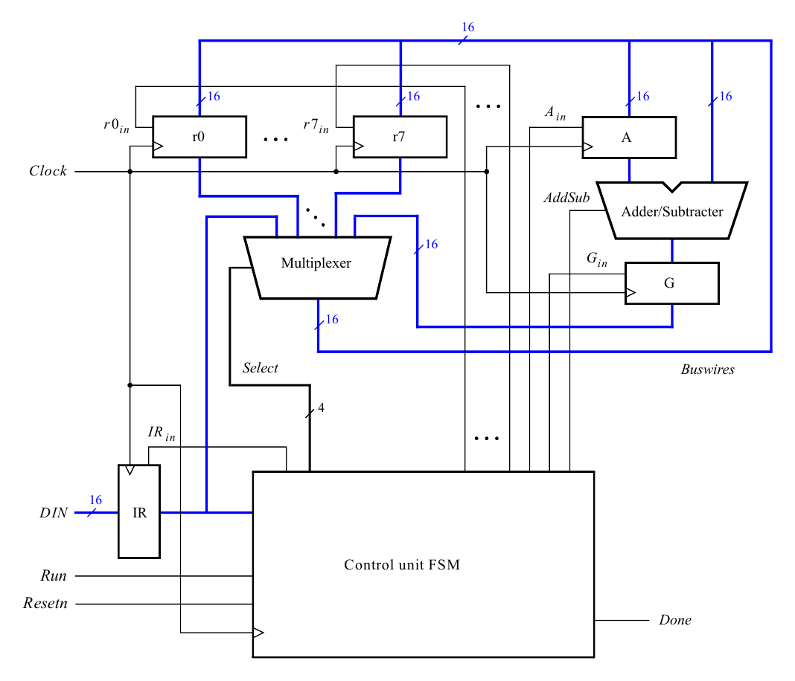

# Simple 16-bit Processor in Verilog

[](https://github.com/vtejareddy14-crypto/16-bit-multicycle-processor/actions/workflows/simulation.yml)

A multi-cycle 16-bit processor written in Verilog. It executes four instructions
(`mv`, `mvt`, `add`, `sub`) over a single shared bus, controlled by a finite-state
machine, and is verified with a self-checking testbench that runs automatically on every push.

## Highlights

- **Bus-based datapath** – eight general-purpose registers (r0–r7), an adder/subtractor
  and the instruction register all communicate over one 16-bit bus
- **FSM control unit** – a 4-step control sequence (T0–T3) drives the bus multiplexer
  and register enables for each instruction
- **Immediate operands** – 9-bit signed immediates, sign-extended to 16 bits
- **Modular RTL** – the top-level `proc` instantiates a reusable register module
  (`regn`, ×10) and a 3-to-8 decoder (`dec3to8`)
- **Automated verification** – testbench checks every result and prints PASS/FAIL;
  GitHub Actions runs it on each commit

## Architecture



| Block | Role |
|---|---|
| **IR** | Holds the current instruction, loaded from `DIN` when `Run` is asserted |
| **r0 – r7** | General-purpose 16-bit registers, written from the bus when their `R_in` enable is high |
| **A** | Holds the first operand of an add/subtract |
| **Adder/Subtracter** | Computes `A + Buswires` or `A − Buswires` (selected by `AddSub`) |
| **G** | Holds the ALU result until it is written back to `rX` |
| **Multiplexer** | Chooses what drives `Buswires`: a register, G, or an immediate from IR |
| **Control unit FSM** | Steps through T0–T3 and asserts `Select`, `R_in`, `A_in`, `G_in`, `AddSub`, `IR_in`, `Done` |

## Instruction Set

| Instruction    | Operation          |
|----------------|--------------------|
| `mv  rX, Op2`  | rX ← Op2           |
| `mvt rX, #D`   | rX[15:8] ← D[7:0], rX[7:0] ← 0 |
| `add rX, Op2`  | rX ← rX + Op2      |
| `sub rX, Op2`  | rX ← rX − Op2      |

`Op2` is either a register `rY` or a 9-bit signed immediate `#D`.

**Encoding (16 bits)**

```
register operand :  III 0 XXX 000000 YYY
immediate operand:  III 1 XXX DDDDDDDDD

III : 000 = mv   001 = mvt   010 = add   011 = sub
XXX : destination register rX      YYY : source register rY
```

## Control Sequence

| Instr. | T0   | T1                         | T2                             | T3                   |
|--------|------|----------------------------|--------------------------------|----------------------|
| mv     | IR_in | Select rY / IR, rX_in, Done |                               |                      |
| mvt    | IR_in | Select IR, rX_in, Done      |                               |                      |
| add    | IR_in | Select rX, A_in             | Select rY / IR, G_in          | Select G, rX_in, Done |
| sub    | IR_in | Select rX, A_in             | Select rY / IR, AddSub, G_in  | Select G, rX_in, Done |

Example – `add r0, r1`: in T1 r0 is copied into A, in T2 the ALU computes A + r1 into G,
and in T3 G is written back to r0.

## Repository Structure

```
16-bit-multicycle-processor/
├── rtl/
│   ├── proc.v              # top level: control FSM, bus multiplexer, adder/subtractor
│   ├── regn.v              # 16-bit register with enable and async active-low reset
│   └── dec3to8.v           # 3-to-8 decoder (selects which register is written)
├── tb/
│   └── proc_testbench.v    # self-checking testbench
├── docs/
│   └── architecture.png    # block diagram
├── .github/workflows/
│   └── simulation.yml      # runs the testbench on every push
├── Makefile
└── README.md
```

Module hierarchy:

```
proc
├── dec3to8  dec_inst
└── regn     reg_0 … reg_7, reg_A, reg_G
```

## Getting Started

**Requirements:** [Icarus Verilog](https://steveicarus.github.io/iverilog/) (and optionally [GTKWave](https://gtkwave.sourceforge.net/) for waveforms).

```bash
# Ubuntu / Debian
sudo apt install iverilog gtkwave
# macOS
brew install icarus-verilog gtkwave
```

**Run the simulation:**

```bash
make sim      # compile and run the testbench
make wave     # open the waveforms in GTKWave
make clean    # remove generated files
```

Without `make`:

```bash
iverilog -g2005 -o sim.out rtl/proc.v rtl/regn.v rtl/dec3to8.v tb/proc_testbench.v
vvp sim.out
```

The design also simulates in ModelSim / Questa: compile the four `.v` files and run `proc_testbench`.

## Verification

The testbench sends each instruction through a `run_instr` task, waits for the four
time steps, and compares the destination register with the expected value. It also
prints the main internal signals (time step, IR, bus, A, G, Done, r0–r3) on every change.

| Instruction | Checks | Expected |
|---|---|---|
| `mv r0, #5` | immediate move | r0 = `0005` |
| `mv r1, #7` | immediate move | r1 = `0007` |
| `add r0, r1` | register add | r0 = `000C` |
| `sub r0, r1` | register subtract | r0 = `0005` |
| `mv r2, r0` | register-to-register move | r2 = `0005` |
| `mvt r3, #0xFF` | move to top byte | r3 = `FF00` |
| `add r3, #0xFF` | immediate add | r3 = `FFFF` |
| `mv r1, #-28` | sign extension of a negative immediate | r1 = `FFE4` |

**Result:**

```
  40 ns | T0 Run=1 IR=0000 Bus=0000 A=0000 G=0000 Done=0 | r0=0000 r1=0000 r2=0000 r3=0000
  50 ns | T1 Run=1 IR=1005 Bus=0005 A=0000 G=0000 Done=1 | r0=0000 r1=0000 r2=0000 r3=0000
  70 ns | T2 Run=0 IR=1005 Bus=0005 A=0000 G=0000 Done=0 | r0=0005 r1=0000 r2=0000 r3=0000
  ...
---- PASS: r0 = 0005
---- PASS: r1 = 0007
---- PASS: r0 = 000c
---- PASS: r0 = 0005
---- PASS: r2 = 0005
---- PASS: r3 = ff00
---- PASS: r3 = ffff
---- PASS: r1 = ffe4

ALL TESTS PASSED
```

## Future Improvements

- Return the FSM to T0 right after `Done`, so `mv` / `mvt` take 2 clock cycles instead of 4
- Connect the processor to an instruction memory and program counter so it runs a stored program
- Synthesize and run the design on an FPGA board
